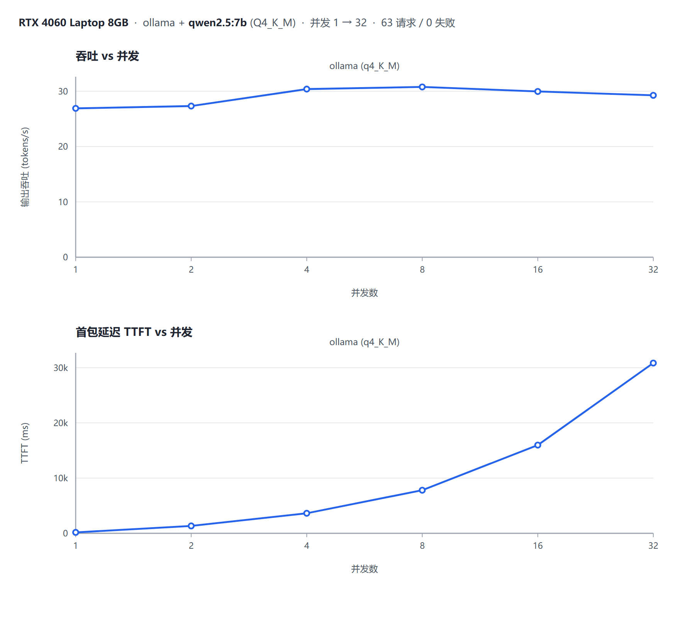

# llm-inference-bench

**大模型推理压测与评测平台** —— 多引擎、多量化等级的推理性能横向评测工具。

[](LICENSE)
[](https://www.python.org/)
[](tests/)
[](https://github.com/yangchuan665/llm-inference-bench/releases)

一句话定位：**把「部署完大模型之后怎么证明它跑得好」这件事工程化。**

给定若干推理引擎（vLLM / Ollama）和若干量化配置（FP16 / INT8 / AWQ / GPTQ），
自动做并发梯度压测，采集吞吐、首包延迟、尾延迟、显存占用，产出一份可直接交付客户的
对比报告，并把指标实时暴露给 Prometheus / Grafana。

> **开发时间**：2026.03 – 2026.06 完成主体开发；2026.09 完成开源整理（补充文档、容器化与 CI）。
> 项目源于实习期间一次 8 卡部署 Qwen2.5-72B 的私有化交付，重点解决「压测口径不统一、结论无法复现」的问题，并沉淀了一套可复用的指标定义与评测方法。

### 一屏看懂

```bash
# 无需 GPU 也能跑通全链路 —— 内置 OpenAI 兼容的 mock 引擎
pip install -r requirements.txt
python scripts/mock_engine.py --port 8102 &
export NO_PROXY="127.0.0.1,localhost"
export VLLM_BASE_URL="http://127.0.0.1:8102" VLLM_MODEL="mock-72b"
python scripts/run_bench.py --engine vllm --quant fp16 --levels 1,2,4,8,16,32
# → data/results/<run>/report.html  （自包含 HTML，隔离内网可直接打开）
```

| | |
| --- | --- |
| **引擎** | vLLM、Ollama，以及任意 OpenAI 兼容端点 |
| **指标** | 吞吐 tokens/s · TTFT 首包延迟 · TPOT · P50/P95/P99 尾延迟 · 显存峰值 |
| **量化** | FP16 / BF16 / INT8 / AWQ / GPTQ 横向对比 + 每 GiB 显存吞吐 |
| **输出** | Markdown 报告 · 自包含 HTML 报告（内联 SVG，无 CDN）· Prometheus 指标 · Grafana 面板 |
| **实测** | 已在 RTX 4060 Laptop 8GB 完成**真机**压测：峰值 **30.8 tokens/s**，并发 2 即饱和 —— 见 [实测数据](#实测数据) |
| **验证** | 313 个单元测试，约 7 秒跑完；无 GPU 亦可端到端验证 |
| **落地** | Docker Compose 一键起监控栈；离线安装与隔离内网可用 |

### 它和「随手写个压测脚本」的区别

- **TTFT 基于流式首个内容分片测量** —— 不是 HTTP 200 到达时刻，否则会漏掉排队与 prefill
- **TPOT = 生成耗时 / (输出 token − 1)** —— 首个 token 已计入 TTFT，重复计算会低估解码速度
- **多卡显存峰值按时序求和** —— 取各卡峰值的最大值，8 卡场景会少报 8 倍
- **每个并发请求独立客户端** —— 复用连接池会把「并发」测成「排队」
- **报告自包含** —— 客户内网常为物理隔离，带外部依赖的报告打开就是白屏

> 这些口径踩过的坑都写在了 [压测方法论](docs/methodology.md) 里，附推导与常见坑点速查表。

---

## 为什么需要它

私有化交付场景里，客户真正关心的不是「你部署起来了」，而是：

| 客户的疑问 | 本工具的答案 |
| --- | --- |
| 这套配置能扛多少并发？ | 并发梯度压测曲线：吞吐随并发增长直到饱和拐点 |
| 用户体感快不快？ | TTFT（首包延迟）—— 流式场景下唯一有意义的体感指标 |
| 延迟长尾会不会爆？ | P50 / P95 / P99 分位统计，只看均值会掩盖长尾 |
| 显存够不够跑更大模型？ | 全阶段显存占用曲线 + 峰值（多卡按时序求和） |
| 换量化能省多少显存、掉多少性能？ | FP16 / INT8 / AWQ 横向对比矩阵 + 换算每 GiB 显存吞吐 |
| 部署完怎么持续看？ | Prometheus 指标 + 预置 Grafana 面板（15 个图） |

---

## 架构

```
                          ┌──────────────────────────────┐
                          │        CLI / FastAPI         │
                          │  run_bench.py  api/server.py │
                          └───────────────┬──────────────┘
                                          │
                          ┌───────────────▼──────────────┐
                          │      bench/runner.py         │
                          │  并发梯度扫描 · 预热剔除 ·    │
                          │  每请求独立客户端 · 墙钟计时   │
                          └───┬───────────────────┬──────┘
                              │                   │
              ┌───────────────▼──────┐   ┌────────▼─────────────┐
              │  engines/client.py    │   │  monitor/gpu.py      │
              │  UnifiedLLMClient     │   │  GpuMonitor          │
              │  · 流式 SSE 解析       │   │  · nvidia-smi 轮询    │
              │  · TTFT=首个内容块     │   │  · 显存曲线/峰值      │
              │  · 优先采信服务端 usage│   │  · 后台线程采样       │
              └───────────┬───────────┘   └────────┬─────────────┘
                          │                        │
        ┌─────────────────┴───────┐                │
        │   OpenAI 兼容 HTTP API   │                │
        │  ┌─────────┐ ┌────────┐ │                │
        │  │  vLLM   │ │ Ollama │ │                │
        │  └─────────┘ └────────┘ │                │
        └─────────────────────────┘                │
                          │                        │
              ┌───────────▼────────────────────────▼─────────┐
              │           metrics/stats.py                   │
              │  RequestResult · StageMetrics                │
              │  分位数(线性插值) · 错误分类 · 失败率门禁      │
              └───┬──────────────┬──────────────┬────────────┘
                  │              │              │
      ┌───────────▼───┐  ┌───────▼──────┐  ┌────▼─────────────┐
      │ metrics/store │  │ monitor/quant│  │ metrics/prometheus│
      │ JSON+CSV 落盘  │  │ 量化横向对比  │  │ 直方图/仪表/Info  │
      │ 结果可复现     │  │ 基线自动识别  │  │ → /metrics        │
      └───────┬───────┘  └───────┬──────┘  └────┬─────────────┘
              │                  │              │
      ┌───────▼──────────────────▼──────┐  ┌────▼──────────────┐
      │        report/generator.py      │  │   Prometheus      │
      │  markdown.py  ·  html.py        │  │        ↓          │
      │  svgchart.py（纯内联 SVG 图表）  │  │    Grafana        │
      │  自包含 HTML，离线可用，无 CDN    │  │  15 面板预置仪表盘 │
      └─────────────────────────────────┘  └───────────────────┘
```

---

## 核心设计决策

以下几点是这个工具区别于「随手写个脚本压一压」的地方。

### 1. TTFT 必须在流式下测量

非流式请求只能拿到总耗时，首包延迟无从得知。本工具强制走 `stream=true`，
并把 TTFT 定义为**第一个携带内容的分片到达的时刻**（而非收到 HTTP 200 的时刻）。
服务端提供的 `usage` 字段若存在则优先采信，否则按分片计数自行统计。

`TPOT` 的算法是 `generation_time / (output_tokens - 1)` —— 减去 1 是因为
首个 token 的等待时间已经计入 TTFT，重复计算会低估单 token 生成速度。

### 2. 每个请求使用独立客户端

压测时若所有并发请求复用同一个 HTTP 连接池，测出来的「并发」实际上是在
连接池队列里排队。本工具为每个并发请求创建独立客户端，确保测量的是
推理引擎的并发能力，而不是 HTTP 客户端的排队能力。

### 3. 显存峰值按时序求和，而非取单卡最大值

多卡场景下这是个容易写错的地方：8 张卡各用 60 GiB，真实占用是 480 GiB。
如果代码写成「取各卡峰值的最大者」，结果会少报 8 倍。

实现上按时间戳对齐后求和再取最大值（见 `monitor/gpu.py::GpuMonitor.curve`），
并有专门的回归测试守着（`test_multi_gpu_peak_not_underreported`）。

### 4. 报告是自包含 HTML

内联 SVG 画图、无 CDN、无 `<script>`。原因很实际：客户内网多为隔离环境，
一个依赖外部资源的报告打开就是白屏。

### 5. 量化对比自动识别基线

`BASELINE_QUANTS = {fp16, bf16, float16, bfloat16, none, unknown}` 中出现即视为基线。
对比结论只陈述事实（"awq 峰值 1874.1 tokens/s，比最优低 2.0%"），
不编造胜负 —— 在 mock 环境里 awq 本来就该略慢于 fp16。

---

## 快速开始

### 环境准备

```bash
python -m venv .venv
source .venv/bin/activate          # Windows: .venv\Scripts\activate
pip install -r requirements.txt     # 运行依赖
pip install -r requirements-dev.txt # 开发/测试依赖
```

### 一分钟跑通（不需要 GPU 和真实模型）

内置了一个 OpenAI 兼容的 **mock 引擎**，带真实感的排队延迟模拟，
用于在无 GPU 环境下验证整条链路。

```bash
# 终端 1：启动 mock 引擎（监听 8102）
python scripts/mock_engine.py --port 8102

# 终端 2：先把 base_url 指向 mock，再跑压测
export NO_PROXY="127.0.0.1,localhost" no_proxy="127.0.0.1,localhost"
export VLLM_BASE_URL="http://127.0.0.1:8102" VLLM_MODEL="mock-72b"
python scripts/run_bench.py --engine vllm --quant fp16 \
    --levels 1,2,4,8,16,32 --max-tokens 256 --output-dir data/results/demo
```

> Windows Git Bash 下必须设置 `NO_PROXY`，否则本地请求可能被系统代理劫持，
> 表现为 `502 upstream connect failed`。

### 打真机

```bash
# 真实 vLLM
python scripts/run_bench.py \
    --base-url http://127.0.0.1:8000/v1 \
    --model Qwen2.5-72B-Instruct \
    --quant fp16 \
    --levels 1,2,4,8,16,32,64 \
    --max-tokens 512 \
    --output-dir data/results/qwen72b

# 真实 Ollama（量化等级写模型名里）
python scripts/run_bench.py \
    --engine ollama --base-url http://127.0.0.1:11434 \
    --model qwen2.5:7b --quant q4_K_M
```

### 量化横向对比

```bash
# 用同一批并发档位分别跑 FP16 / AWQ，产物落在同一 run 目录下
python scripts/run_bench.py --run-id quant-72b --output-dir data/results \
    --base-url http://127.0.0.1:8000/v1 --model Qwen2.5-72B-Instruct --quant fp16
python scripts/run_bench.py --run-id quant-72b --output-dir data/results \
    --base-url http://127.0.0.1:8000/v1 --model Qwen2.5-72B-AWQ --quant awq

# 报告里会自动生成量化对比章节
```

### 从已有结果重新出报告

```bash
python scripts/run_bench.py --report-only --from-results data/results/demo
```

### 服务化

```bash
python scripts/serve.py --host 0.0.0.0 --port 8090
```

因为一次完整扫描要跑几分钟，接口设计成**异步任务模型**：

| 方法 | 路径 | 说明 |
| --- | --- | --- |
| GET | `/` | 服务信息与端点清单 |
| GET | `/health` | 存活探针 |
| GET | `/engines` | 列出已配置引擎 |
| POST | `/engines/check` | 探测引擎可达性与模型是否已加载 |
| POST | `/bench` | 提交压测任务，**立即返回 job_id** |
| GET | `/jobs` | 任务列表 |
| GET | `/jobs/{id}` | 轮询进度（`progress` 0→1） |
| GET | `/jobs/{id}/result` | 取结果 JSON |
| GET | `/jobs/{id}/report` | 取 HTML 报告 |
| DELETE | `/jobs/{id}` | 删除任务记录 |
| GET | `/reports` | 列出历史报告 |
| GET | `/reports/{run_id}/{filename}` | 按 run 取报告文件 |
| POST | `/compare` | 对同一 run 下多份结果做量化对比 |
| GET | `/metrics` | Prometheus 抓取端点 |
| GET | `/metrics/snapshot` | 指标快照（JSON，用于调试） |

### 监控栈

```bash
cd deploy && docker compose up -d
# Prometheus  → http://localhost:9090
# Grafana     → http://localhost:3000  (admin/admin，匿名只读)
```

Grafana 数据源与仪表盘由 provisioning 自动装载，仪表盘 JSON 由
`scripts/gen_grafana_dashboard.py` 生成（15 面板，含引擎模板变量）。

---

## 项目结构

```
llm-inference-bench/
├── config/settings.py        # EngineTarget / BenchConfig / MonitorConfig
├── engines/client.py         # 统一 OpenAI 兼容客户端（流式 TTFT 采集）
├── bench/runner.py           # 并发梯度扫描、预热剔除、显存窗口对齐
├── metrics/
│   ├── stats.py              # RequestResult / StageMetrics / 分位数 / 错误分类
│   ├── store.py              # JSON+CSV 落盘、结果反序列化、文件命名防碰撞
│   └── prometheus.py         # 直方图/仪表/Info，定制 LLM 延迟桶
├── monitor/
│   ├── gpu.py                # nvidia-smi 轮询、显存曲线（时序求和峰值）
│   └── quant.py              # 量化分组、基线识别、对比矩阵、结论生成
├── report/
│   ├── generator.py          # 报告编排入口
│   ├── markdown.py           # 7 章节 Markdown 报告
│   ├── html.py               # 自包含 HTML 报告
│   ├── svgchart.py           # 纯内联 SVG 折线图/柱状图（含对数轴）
│   └── fmt.py                # 自适应单位格式化
├── api/server.py             # FastAPI 服务（异步任务模型）
├── scripts/
│   ├── run_bench.py          # CLI 入口
│   ├── serve.py              # 服务启动器
│   ├── mock_engine.py        # OpenAI 兼容 mock 引擎（无 GPU 也能验证）
│   └── gen_grafana_dashboard.py
├── deploy/                   # Dockerfile / docker-compose / Prometheus / Grafana
├── tests/                    # 313 个单元测试
└── data/results/             # 压测产物（JSON / CSV / 报告）
```

---

## 报告示例

报告分 7 个章节：

1. **概览** —— 被测配置、并发档位、结论速览
2. **测试环境** —— Python / 平台 / GPU 型号驱动、被测模型与量化等级
3. **吞吐能力** —— 各并发档位 tokens/s，含吞吐-并发曲线
4. **延迟特性** —— TTFT / TPOT / P50 / P95 / P99 表格，含延迟-并发曲线
5. **显存占用** —— 全阶段显存曲线与峰值，按并发档位拆表
6. **量化横向对比** —— 基线识别、吞吐相对比、每 GiB 显存吞吐
7. **结论与建议** —— 饱和拐点、稳定性提示、选型建议

产物同时输出 `report.md` 与 `report.html`。

---

## 实测数据

> 下面这次运行是**真机真模型**，不是 mock：8 GiB 消费级显卡 + Ollama +
> `qwen2.5:7b`（Q4_K_M）。原始产物**全部随仓库发布**，可直接核对，也可以自己复算：
>
> - [`report.md`](data/results/run-20261009-103334/report.md) —— 完整 7 章节报告（GitHub 可直接阅读）
> - [`report.html`](data/results/run-20261009-103334/report.html) —— 自包含图表版（内联 SVG，无外部依赖）
> - [`ollama__qwen2.5_7b__q4_k_m.json`](data/results/run-20261009-103334/ollama__qwen2.5_7b__q4_k_m.json) —— 原始结果，可喂给 `--report-only` 重新出报告
>
> ⓘ 这份 JSON 的内部字段 `result_stem` 仍是修复前的写法
> （`ollama__qwen2.5:7b__q4_k_m`，**含冒号**），而实际文件名已由修复后的
> `_safe_slug` 生成。这不是数据被改过 —— 它本身就是「冒号触发 NTFS 备用数据流」
> 那个 bug 的现场记录，见 [`CHANGELOG.md`](CHANGELOG.md) 的 Fixed 段。



> 一眼看懂：**吞吐到并发 8 就压平了（30.8 tokens/s），首包延迟却从 169 ms 一路涨到 30.8 s。**

**环境与参数**

| 项 | 值 |
| --- | --- |
| GPU | NVIDIA GeForce RTX 4060 Laptop GPU，8.0 GiB |
| 引擎 / 模型 | Ollama / `qwen2.5:7b`（Q4_K_M） |
| 并发梯度 | 1 → 32（1, 2, 4, 8, 16, 32） |
| 每请求生成 | 256 tokens，温度 0，流式，预热 2 次 |
| 规模 | 63 个请求，**0 失败**，总耗时 222.94 s |

**吞吐与延迟**

| 并发 | 吞吐 tokens/s | 相对加速比 | TTFT 均值 | TPOT 均值 | 端到端 P99 |
| ---: | ---: | ---: | ---: | ---: | ---: |
| 1 | 26.9 | 1.00× | 168.81 ms | 21.64 ms | 2159.52 ms |
| 2 | 27.3 | 1.02× | 1335.32 ms | 23.93 ms | 4607.57 ms |
| 4 | 30.4 | 1.13× | 3636.49 ms | 23.44 ms | 8871.39 ms |
| **8** | **30.8（峰值）** | 1.14× | 7804.78 ms | 22.96 ms | 17178.87 ms |
| 16 | 30.0 | 1.11× | 15979.12 ms | 21.56 ms | 32414.35 ms |
| 32 | 29.3（反降） | 1.09× | **30839.10 ms** | 21.69 ms | **62798.84 ms** |

显存峰值 **5.6 / 8.0 GiB（70.3%）**，全程 GPU 平均利用率 71.9%（305 个采样点）。

**读出来的三条结论**

1. **并发 2 就已饱和。** 从并发 1 到峰值吞吐只拿到 **1.14×** 加速比，之后继续
   加压吞吐不升反降。8 GiB 卡跑 7B Q4_K_M 的容量上限很低 —— 按「并发 = 用户数」
   去规划的话，第 3 个用户开始就已经在排队了。
2. **饱和点之后加压只推高延迟。** 并发 1 → 32，TTFT 从 168.81 ms 恶化到
   **30839.10 ms（182 倍）**，端到端 P99 从 2.2 s 涨到 62.8 s。
   这就是「只看峰值吞吐会给出错误容量结论」的直接证据，也是本项目做并发梯度
   扫描而不是单点压测的理由。
3. **TPOT 几乎不随并发变化（21.6 ~ 23.9 ms）。** 单 token 解码速度很稳定，说明
   瓶颈在请求排队与调度，而不是算力被压满。要提吞吐得从调度侧动手，不是换一个
   更快的解码 kernel。

> ⚠️ **别和 demo 混淆**：仓库自带的 [`data/results/demo/`](data/results/demo/) 用的是
> 内置 **mock 引擎**（延迟是模拟出来的），只用于零 GPU 验证全链路，
> **不能用来推断任何真实硬件性能**。上表是目前唯一一份真机数据。

---

## 测试

```bash
python -m pytest tests -q
```

313 个测试，约 7 秒跑完，覆盖：

| 测试文件 | 用例数 | 重点 |
| --- | --- | --- |
| `test_stats.py` | 43 | 分位数插值、TPOT 边界（单 token）、错误分类 |
| `test_quant.py` | 46 | 基线识别、比值计算、结论措辞 |
| `test_gpu_monitor.py` | 34 | 多卡时序求和峰值、nvidia-smi 缺失降级 |
| `test_runner.py` | 21 | 并发扫描、预热剔除、失败率门禁 |
| `test_store.py` | 40 | 落盘/回读一致性、文件名防碰撞（含 Windows 保留字符） |
| `test_report.py` | 61 | Markdown/HTML 章节、SVG 无外部引用 |
| `test_api.py` | 35 | 端点契约、异步任务生命周期 |
| `test_config.py` | 33 | 环境变量覆盖、URL 归一化 |

写测试与真机压测过程中发现并修掉了 6 个真实缺陷（详见 [`CHANGELOG.md`](CHANGELOG.md) 的 Fixed 段）：

1. 多卡显存峰值取各卡最大值 → 改为按时间戳求和（8 卡场景原少报 8 倍）
2. `prometheus_client` 的 `Info.info()` 逐字段调用会整体替换标签集 → 一次传完整字典
3. 结果文件名只用引擎名，FP16 与 AWQ 互相覆盖 → 改为 `<引擎>__<模型>__<量化>`
4. 全部请求失败的运行退出码仍为 0（CI 会误判通过）→ 改为返回 2 并打印失败详情
5. 错误样本列表无上限 → 限制为 5 条，避免结果文件膨胀数十倍
6. `_safe_slug` 放行 `:`，`qwen2.5:7b` 触发 NTFS 备用数据流 → 结果文件被写进数据流、目录里只剩 0 字节（真机跑 Ollama 时暴露）

---

## 与相近工具的关系

不是要替代它们，定位不同：

| 工具 | 定位 | 本项目的差异 |
| --- | --- | --- |
| `vllm bench` / `vllm benchmark_serving` | vLLM 官方压测脚本 | 只覆盖 vLLM；本项目支持多引擎横向对比，且产出可直接交付的对比报告 |
| `locust` / `wrk` / `ab` | 通用 HTTP 压测 | 不识别 LLM 语义，拿不到 TTFT / TPOT / token 吞吐，也无法对齐显存曲线 |
| `genai-perf`（NVIDIA） | LLM 推理性能剖析 | 更侧重单模型深度剖析；本项目侧重**多配置横向对比 + 量化选型决策** |
| `evalscope`（阿里） | 模型能力评测 | 评的是「模型答得好不好」，本项目评的是「推理跑得快不快」——两者互补 |

本项目特别关注的场景是**私有化交付**：给定几套引擎 + 量化组合，得出「该给客户上哪一套」的结论，并留下一份能放进验收报告的材料。

---

## 参与贡献

欢迎提 Issue 和 PR。开始之前请先读 [`CONTRIBUTING.md`](CONTRIBUTING.md)，
里面列了 5 条**不能想当然的指标口径**——改动指标相关逻辑前必看，否则很容易改错。

```bash
# 快捷上手：不需要 GPU
pip install -r requirements.txt -r requirements-dev.txt
python -m pytest tests -q          # 313 passed in ~7s
python scripts/mock_engine.py --port 8102 &
```

只要发现指标口径有问题、报告有误导性表述，或者在你的硬件上跑出了反直觉的结果，
都欢迎开 Issue 讨论——**这类反馈比加功能更有价值**。

---

## 已知限制

- **mock 引擎的延迟是模拟的**，只用于验证链路，不能用来推断真实硬件性能
  （仓库自带的 `data/results/demo/` 即属此类；真机数据见[实测数据](#实测数据)）。
- 显存监控依赖 `nvidia-smi`，非 NVIDIA 平台会静默降级为「无显存数据」。
- `/compare` 目前只能在**同一个 run 目录**内对比，跨 run 对比需先合并结果文件。
- Prometheus 直方图是累计值，跨多次压测会持续累加，重启服务才归零。
- 未实现多机分布式压测；单进程压测在极高并发（>256）下可能受 GIL 限制。

---

## License

MIT，见 [`LICENSE`](LICENSE)。

